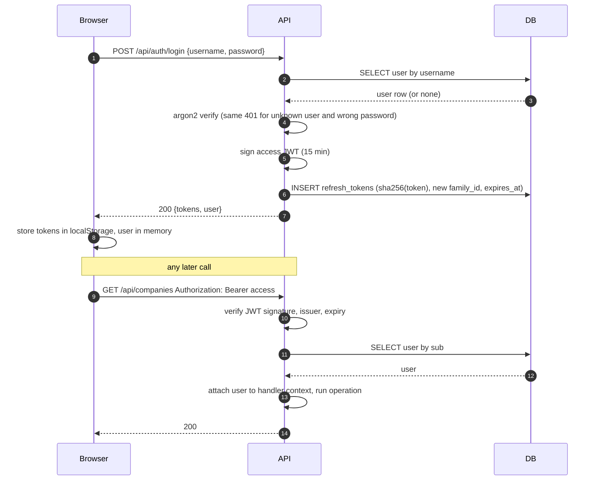
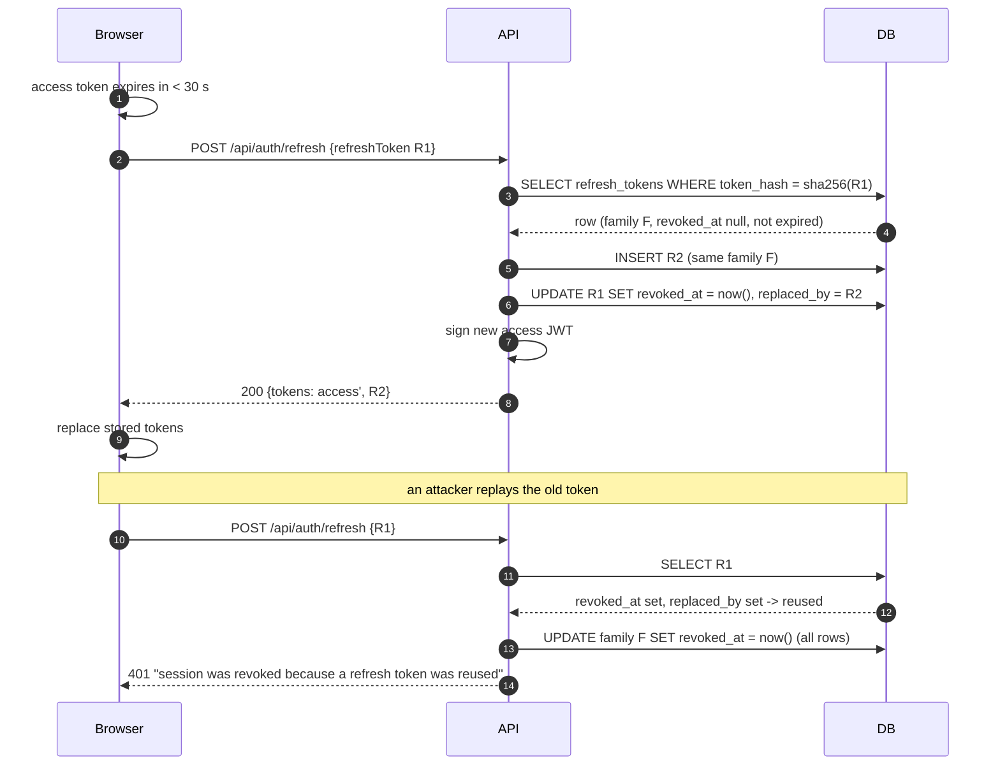
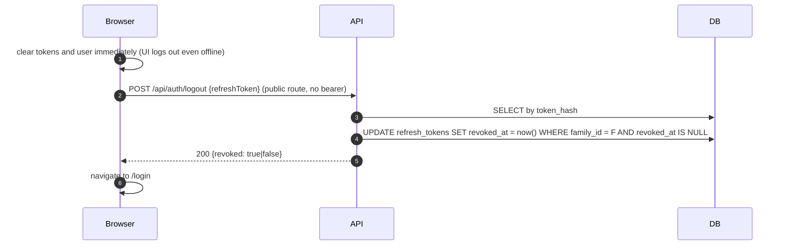
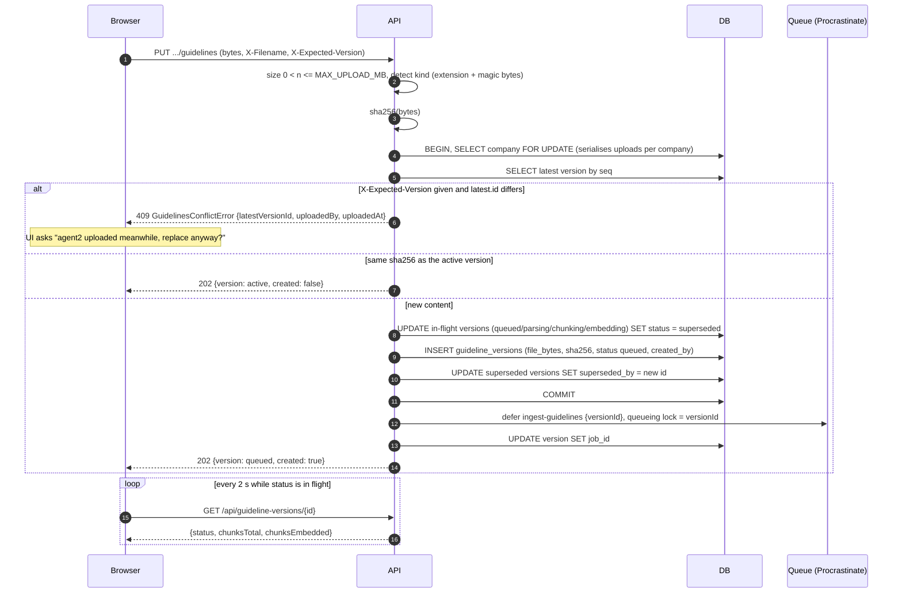
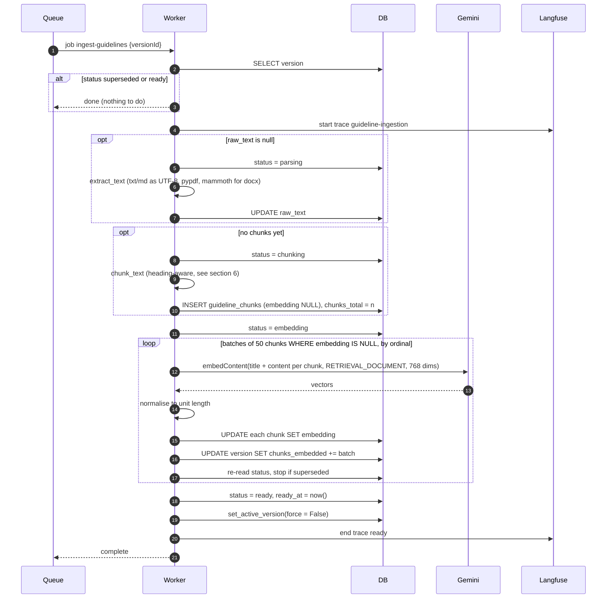
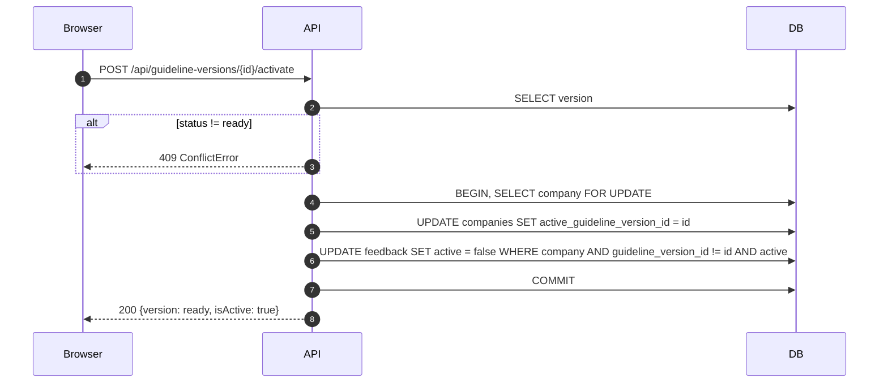
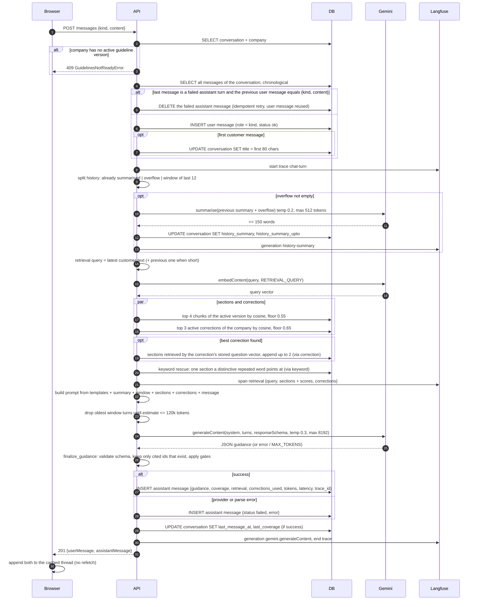
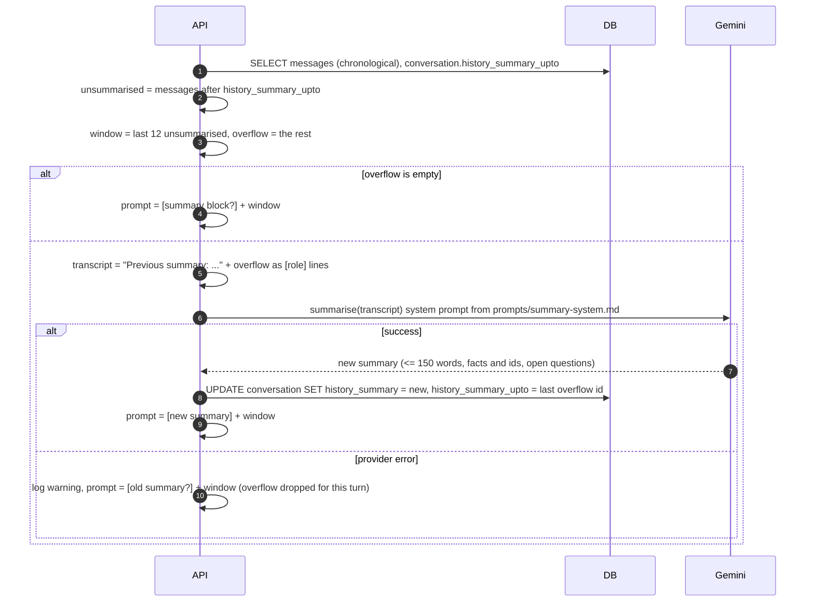
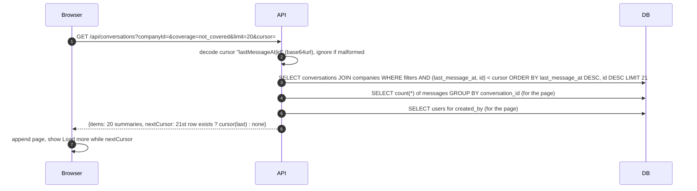
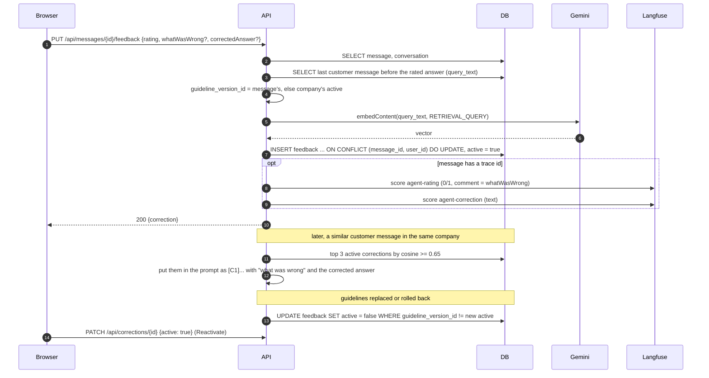

# Low-level design

This document describes how the AI Support Assistant works at the level of requests, database
rows and provider calls. It complements the high-level design (`docs/hld.md`), which explains
_why_ the architecture looks the way it does, and the evaluation report
(`docs/evaluation-report.md`), which holds the measurements behind the tunables quoted here.
Every statement below is taken from the code as of this revision (the Python backend: FastAPI,
SQLAlchemy, Procrastinate); file paths are given so a reader can verify them.

**Conventions.** Sequence diagrams are Mermaid. Participants: **Browser** (the React app),
**nginx** (reverse proxy), **API** (FastAPI + Pydantic on uvicorn), **Worker** (the
ingestion process, same image as the API), **DB** (PostgreSQL 17 with pgvector), **Queue**
(Procrastinate tables inside the same database), **Gemini** (Google GenAI API) and **Langfuse**
(optional tracing). Configuration names in `UPPER_CASE` are environment variables read at
start-up and validated in `api/app/config.py` (§8).

## Contents

1. Runtime components
2. Authentication
3. Guideline upload and ingestion
4. Chat flow (one turn)
5. Chat history
6. Chunking, embeddings and retrieval
7. Data model
8. Configuration reference
9. Error model
10. Failure modes

---

## 1. Runtime components

| Component | Process / image                                                                | Responsibilities                                                                                                                                                     |
| --------- | ------------------------------------------------------------------------------ | -------------------------------------------------------------------------------------------------------------------------------------------------------------------- |
| nginx     | `nginx` image                                                                  | Serves the built web app, proxies `/api/*` to the API, terminates TLS in the optional HTTPS profile                                                                  |
| Web       | static build inside nginx                                                      | React 19, TanStack Router and Query, typed client generated from the OpenAPI document, tokens in `localStorage`                                                      |
| API       | `api` image, `uvicorn app.server:app` (`UVICORN_WORKERS` processes, default 2) | Runs migrations, seeds users and companies (under an advisory lock so workers do not race), serves every `/api` operation (FastAPI routers), enqueues ingestion jobs |
| Worker    | `api` image, `python -m app.worker`                                            | Consumes `ingest-guidelines` jobs: parse, chunk, embed, activate                                                                                                     |
| DB        | `pgvector/pgvector:pg17`                                                       | All application tables (§7), the Procrastinate job tables, Alembic's version table                                                                                   |
| Gemini    | external                                                                       | `gemini-embedding-2` for embeddings, `gemini-3.8-flash` (medium thinking) for answers and history summaries                                                          |
| Langfuse  | optional compose profile                                                       | Receives one trace per chat turn and per ingestion, plus agent feedback as scores                                                                                    |

Every HTTP request follows the same path: nginx forwards it to uvicorn, the request-id
middleware (`api/app/request_id.py`) binds the id, the auth middleware
(`api/app/auth/middleware.py`) authenticates it (§2.2), FastAPI validates path, query, header and
body parameters against the Pydantic models in `api/app/schemas.py`, calls the matching router in
`api/app/routers/`, which hands the work to a service with a per-request database session
(`api/app/deps.py`), and serialises the response model or the modelled error (`api/app/errors.py`).

---

## 2. Authentication

Two credentials are issued at login (`api/app/auth/service.py`):

| Credential    | Format                                                                               | Lifetime                        | Storage                                       |
| ------------- | ------------------------------------------------------------------------------------ | ------------------------------- | --------------------------------------------- |
| Access token  | JWT, HS256, issuer `ai-support-assistant`, `sub` = user id, `username`, unique `jti` | `ACCESS_TOKEN_TTL_MINUTES` (15) | Not stored server-side, verified by signature |
| Refresh token | 32 random bytes, base64url                                                           | `REFRESH_TOKEN_TTL_DAYS` (7)    | SHA-256 hash in `refresh_tokens` (§7.2)       |

The browser keeps both in `localStorage` (`web/src/auth/atoms.ts`) so a reload does not log the
agent out. Passwords are argon2 hashes in `users.password_hash`; the seeded accounts come from
`SEED_USERS`.

### 2.1 Login and an authenticated request

### 2.2 Middleware order

The auth middleware runs **before** routing and body parsing, so an unauthenticated caller gets a
401 without any validation detail leaking. Which routes are public is not hard-coded: at
start-up `create_app` reads the application's own OpenAPI document and treats every operation
declared with `security: []` (`openapi_extra=PUBLIC` on the route) as public. Today that is
`Health`, `Login`, `RefreshToken` and `Logout`; the Swagger UI and the document itself are public
too. The signature and expiry are verified on every request; the database lookup that follows
(does the user still exist) is cached in the process for 30 seconds per token subject, so a
protected request normally costs its own queries only. A request with a malformed or expired bearer on a protected route
gets the message "Your session is invalid or has expired"; one with no header gets
"Authentication required".

### 2.3 Refresh, rotation and reuse detection

The web client (`web/src/api/client.ts`) refreshes **proactively** when the access token is within
30 seconds of expiry, and **reactively** once when a protected call returns 401, replaying the
original request with the new token. Concurrent refreshes share one in-flight promise.

Outcomes of `rotate` in `api/app/auth/refresh_tokens.py`:

| Presented token             | Outcome   | Effect                                        |
| --------------------------- | --------- | --------------------------------------------- |
| Unknown hash                | `unknown` | 401                                           |
| Revoked, `replaced_by` set  | `reused`  | whole family revoked, 401                     |
| Revoked, `replaced_by` null | `revoked` | (logged out) family revoked again, 401        |
| Expired                     | `expired` | 401                                           |
| Valid                       | ok        | new token in the same family, old one revoked |

On any 401 from the refresh endpoint the client clears the session and the route guard
(`web/src/auth/require-session.tsx`) navigates to `/login?next=<current page>` exactly once.

### 2.4 Logout

The access token stays valid until its 15-minute expiry (it is stateless); the refresh family is
dead, so the session cannot be extended.

### 2.5 Authorization

There are no roles. Every authenticated agent may create companies, upload guidelines, read any
company's guidelines and corrections, and reactivate corrections. The one ownership rule is on
conversations: `conversations.created_by` is the agent who started the thread, and the service
layer scopes every access to it. Listing (§5.3) always filters on the caller; reading, paging,
sending a message and rating an answer load the conversation with the caller's id and answer
`NotFoundError` (404) for another agent's thread rather than 403, so an id cannot be probed for
existence. Company conversation counts are the caller's own. Corrections are the deliberate
exception: retrieved per company regardless of who wrote them (§5.6).

---

## 3. Guideline upload and ingestion

A company's guidelines are a sequence of **versions** (`guideline_versions`, §7.4). Exactly one
version is _active_ (`companies.active_guideline_version_id`) and only a `ready` version can be
active. The API accepts the upload and returns at once; the worker does the expensive part.

Status lifecycle: `queued → parsing → chunking → embedding → ready`, with `failed` (retryable)
and `superseded` (a newer upload arrived first) as terminal states. The UI shows the in-flight
states as _queued → extracting → splitting → indexing_.

### 3.1 Upload

`PUT /api/companies/{companyId}/guidelines` with the raw file as the body and three headers:
`X-Filename`, `X-File-Content-Type`, and optionally `X-Expected-Version` (the latest version id
the agent's page knew about). Handler: `api/app/guidelines/service.py`, `upload`.

Design points:

- **Row lock on the company** makes "latest version" and "supersede in-flight" atomic across two
  agents uploading at the same moment.
- **Conflict detection is optimistic**: the page sends the version id it rendered; if a newer one
  exists the API refuses and names who uploaded it, and the UI offers to retry without the
  header.
- **Duplicate upload** of the active file is a no-op, so an accidental double click does not
  create a version.
- **Superseding** never touches a `ready` version: the previous active version keeps serving
  chat until the new one is ready (§3.3).
- **The file bytes are stored in the row**, so the worker needs no shared volume and a version
  can be re-processed later.

### 3.2 Ingestion job

`api/app/ingestion/job.py`, run by the worker through Procrastinate. Each stage re-reads the version
and stops quietly if it was superseded meanwhile. Every stage is resumable: a retried job skips
what was already done.

Failure handling:

- Any raised error sets `status = failed` with a human-readable `error` (Gemini's JSON error
  envelope is unwrapped, truncated to 500 chars) and re-raises, so Procrastinate retries: up to 5
  attempts with exponential backoff from 5 s.
- After the automatic retries are exhausted the version stays `failed`; an agent can press
  **Retry**, which resets `chunks_embedded`, clears `error` and enqueues a fresh job. Because
  `raw_text` and the chunk rows survive, the retry resumes at the embedding stage.
- Embedding calls themselves retry 4 times on HTTP 429, 500 and 503 (1 s doubling), which
  covers free-tier throttling before the job-level retry kicks in.

### 3.3 Activation, rollback and corrections

`set_active_version(session, company_id, version_id, force=...)` in `api/app/guidelines/service.py`
runs in a transaction with the company row locked:

- **Worker finishing a job** calls it with `force = false`: if the company already has an active
  version with a higher `seq`, the older job that finished late does **not** overwrite it.
- **Agent pressing "Make active"** on an older `ready` version (rollback) calls it with
  `force = true`.
- In both cases every active correction written against a **different** version is set
  `active = false` (§5.6), because a correction is only known to be valid for the guideline text
  it was written against. The company page lists them as _Inactive (guidelines changed)_ with a
  **Reactivate** action.

---

## 4. Chat flow (one turn)

`POST /api/conversations/{id}/messages` with `kind` (`customer` or `instruction`) and `content`
(1 to 20,000 chars). Handler: `send_message` in `api/app/conversations/service.py`. Both the
agent's message and the assistant's answer are persisted, even when the provider fails.

Step-by-step detail:

1. **Guard.** The conversation must belong to the calling agent (another agent's id answers 404,
   see §2.5), and the company must have an active version: no active version means no grounding
   is possible, so the turn is refused before anything is stored (the UI disables chat for such
   companies).
2. **Idempotent retry.** A failed assistant turn leaves the agent's message in place with a
   **Retry** button. Retrying sends the same `{kind, content}`; the service recognises the pattern
   "failed assistant turn preceded by an identical user message", deletes the failed row and
   reuses the user message, so a retry never duplicates the customer text.
3. **History window and rolling summary.** See §5.2.
4. **Retrieval query.** For a customer message shorter than 120 characters the previous customer
   message is prepended ("Yes, a replacement please" alone retrieves nothing useful). For an
   agent instruction ("make it shorter") the last customer message is used, since the instruction
   is about the same case.
5. **Retrieval.** Vector top-k with a floor, correction few-shots, correction-anchored sections
   and the keyword rescue; the mechanics and thresholds are in §6.3. Retrieval and prompt
   assembly run inside the same failure handling as generation: if embedding the message fails
   after its retries, the turn is stored as a failed assistant message (step 10) rather than
   surfacing as a 500 with the agent's message left unanswered.
6. **Prompt.** Fixed text comes from `api/prompts/*.md` (system rules, the "no sections" notice,
   the summary acknowledgement); `api/app/rag/prompt.py` adds the dynamic parts. Sections are
   labelled `[S1]…[Sn]`, corrections `[C1]…`, the customer text is wrapped in
   `<customer_message>` with spoofed closing tags stripped, instructions in
   `<agent_instruction>`, the summary in `<conversation_summary>`. Older assistant turns in the
   window are compacted to `coverage`, `recommendedReply` and `clarifications` rather than the
   full JSON.
7. **Budget.** Tokens are estimated at 4 characters each; window turns are dropped oldest-first
   until the estimate fits `CHAT_PROMPT_TOKEN_BUDGET` (120k). The latest turn, which carries the
   retrieved context, is never dropped. The share of the model's 1,048,576-token window used is
   reported to the trace as `contextUsedPct`.
8. **Generation.** JSON mode with a fixed response schema (the `AssistantGuidance` shape in
   `api/app/rag/guidance.py`), temperature 0.3, `max_output_tokens` 8192, thinking level `GEMINI_THINKING_LEVEL` (medium;
   thinking tokens count against the same budget). A `MAX_TOKENS` or `SAFETY` finish reason is
   turned into a specific `ChatModelError` rather than a truncated answer. Every Gemini call has a
   per-request timeout (`GEMINI_TIMEOUT_MS`, 60 s), so a hung provider fails the turn instead of
   holding the request open.
9. **Gate** (`finalize_guidance` in `api/app/rag/guidance.py`). Parse, validate against the
   schema, keep only citations whose ids were actually provided (deduplicated), then override the
   model when needed: no retrieved section ⇒ `not_covered` with escalation to "Team lead / senior
   agent"; a recommended reply or handling step that looks like source code (fenced block or a
   `def`/`import`/`function`/`console.log` line) ⇒ `not_covered`, defence against "write me
   code" injections.
10. **Persist and stamp.** The assistant row stores everything the _Why this answer_ panel
    shows; the conversation gets its `last_message_at` and, for a successful turn, its
    `last_coverage`. A failed turn keeps the previous coverage.

---

## 5. Chat history

### 5.1 Storage model

A **conversation** belongs to one company and one creating agent and holds an ordered list of
**messages** with roles `customer`, `instruction` and `assistant`. Every assistant message keeps
its full structured `guidance`, the sections retrieved with their scores and how they got there
(`via` correction or keyword), the corrections used, model, token counts, latency, the guideline
version answered from and the Langfuse trace id. Nothing is ever rewritten after the fact except
the deletion of a failed assistant row on retry (§4, step 2); history is append-only.

### 5.2 History window and rolling summary

The prompt never replays a whole thread. `CHAT_HISTORY_WINDOW` (12) messages are sent verbatim;
everything older is folded into one short paragraph stored on the conversation and extended
incrementally, so a fifty-turn chat still knows the order number from turn one.

Properties: the summary is computed at most once per message (the `_upto` pointer moves
forward), a failed summary call never fails the turn, and the summary is sent as a user turn
followed by a fixed model acknowledgement so the model treats it as trusted context rather than
customer text (rule 9b of the system prompt).

### 5.3 Listing conversations

`GET /api/conversations` returns only the calling agent's conversations (the query is always
scoped to `created_by`), with optional `companyId`, `coverage`, `cursor`, `limit`
(1 to 100, default 20). The History page keeps its filters in the URL and loads pages with an
infinite query and a **Load more** button; the chat page's sidebar is the same query filtered by
company.

Indexes behind the filters: `(company_id, last_message_at)` for a company, `(last_message_at)`
for the global list, `(last_coverage, last_message_at)` for the coverage filter; every variant
adds `created_by = caller`. Because coverage is denormalised on the conversation, no per-row subquery into
`messages` is needed.

### 5.4 Paging messages of one conversation

`GET /api/conversations/{id}?limit=50&before=<olderCursor>` returns the newest page in
chronological order plus `olderCursor` when older messages exist. The web app keeps one cached
object per conversation: the loaded pages merged into one list and the current `olderCursor`.
**Load earlier messages** fetches the previous page and prepends it without moving the scroll
position; sending a message appends to the same cache and adjusts `messageCount` by the number of
rows added rather than recounting.

The cursor is the same `"createdAt|id"` keyset as §5.3 on the `(conversation_id, created_at)`
index, so a thread of any length costs one indexed range scan per page.

### 5.5 "Why this answer"

The History detail page renders, per assistant message and straight from the stored row: the
retrieved sections with similarity scores and the `via` tag, the corrections used with their
scores, coverage, escalation, clarifications, agent decisions, notes, model, prompt, thinking,
output and total tokens (thinking tokens are the model's reasoning, billed as output; the total is
the provider's figure for the whole call), latency and the guideline version id. Nothing is recomputed, so the panel
shows what the model actually saw at the time even after the guidelines changed.

### 5.6 Feedback and corrections lifecycle

One agent can rate a given answer once (unique `(message_id, user_id)`); rating again updates the
row. A thumbs-up stores the question so that "a previous answer to this was rated helpful"
can be shown to the model as a positive example; a thumbs-down carries the correction text that
becomes the few-shot.

---

## 6. Chunking, embeddings and retrieval

### 6.1 Chunking (`api/app/ingestion/chunker.py`)

Guideline documents are organised by topic, and one topic per chunk is the best retrieval unit:
a section such as "4. Returns and Refunds" with its steps and sample reply is exactly what the
model needs to answer a refund question, and nothing else.

**Normalisation.** Line endings to `\n`, trailing spaces removed, control characters other than
tab and newline removed, runs of three or more blank lines collapsed to one blank line.

**Heading detection** (`heading_title`), applied per line, first match wins:

| Pattern  | Regex (simplified)                         | Extra rule                                               | Example                  |
| -------- | ------------------------------------------ | -------------------------------------------------------- | ------------------------ |
| Markdown | `^#{1,6}\s+title`                          | –                                                        | `## Refunds`             |
| Numbered | `^\d{1,3}[.)]\s+title` (title ≤ 120 chars) | title must not end in `.`, `!` or `?` and has ≤ 12 words | `4. Returns and Refunds` |
| All caps | `^[A-Z][A-Z0-9 &/',-]{2,79}$`              | must contain a run of ≥ 3 capitals                       | `BILLING`                |

The numbered rule's extra conditions stop numbered _steps_ ("1. Verify the order.") from being
read as headings.

**Section split.** The text is cut at every heading; text before the first heading forms an
untitled section; empty sections are dropped.

**Size control.** Tokens are estimated as `ceil(chars / 4)`. A section of at most
`maxTokens` (800) becomes one chunk. A longer section is split into windows over its paragraphs
(blank-line separated): paragraphs are packed up to `targetTokens` (400); when a window is
flushed, the last paragraphs worth about `overlapTokens` (60) are carried into the next window
so a fact on a boundary is in both; a single paragraph above 800 tokens (no blank lines at
all) is split on sentence ends. Window chunks are titled `"<section> (part n)"`.

**Cleanup.** A chunk shorter than 40 characters with the same title as its predecessor (a lone
heading line) is merged into it. Ordinals are renumbered from 0 in document order.

**Result on the seed data.** Bookshop yields 7 chunks (one per numbered topic, 90 to 130 tokens
each); VPN SaaS yields 10. Neither needs the window fallback. Documents without recognisable
headings (bold-only headings in PDF or DOCX, plain prose) fall back to overlapping windows of
about 400 tokens; the company page shows the extracted text and the resulting sections so an
agent can see which path was taken.

### 6.2 Embeddings (`api/app/rag/embeddings.py`)

| Property      | Value                                                                                                                                                            |
| ------------- | ---------------------------------------------------------------------------------------------------------------------------------------------------------------- |
| Model         | `gemini-embedding-2` (`GEMINI_EMBEDDING_MODEL`); switching models requires `uv run python -m app.db.reembed` so chunk and query vectors come from the same model |
| Dimensions    | **768**, requested with `output_dimensionality` (the model is Matryoshka-trained, so truncation keeps the leading, most informative components)                  |
| Task type     | `RETRIEVAL_DOCUMENT` for chunks, `RETRIEVAL_QUERY` for customer messages and correction questions (asymmetric embeddings)                                        |
| Text embedded | `"<title>\n<content>"` for a chunk, the raw text for a query                                                                                                     |
| Normalisation | Every vector is scaled to unit length, so cosine similarity equals the dot product and `1 - (a <=> b)` in pgvector is the cosine similarity in [−1, 1]           |
| Batching      | Up to 100 texts per call, sent as one `Content` each (as strings the SDK merges them into one document); the ingestion job asks for 50 chunks at a time          |
| Retries       | 4 attempts on HTTP 429/500/503, 1 s doubling; each call times out after `GEMINI_TIMEOUT_MS`                                                                      |
| Storage       | `vector(768)` column, HNSW index with `vector_cosine_ops`                                                                                                        |

**Why 768.** The evaluation compared 768, 1536 and 3072 on the labelled set: 768 was best or tied
on every ranking metric (top-1 82.5%, top-4 recall 100%) while costing a quarter of the storage
of 3072, which was strictly worse and would also need `halfvec` because HNSW indexes cap at 2000
dimensions for `vector`. Cost is per input token, not per dimension. The value is fixed in two
places that must agree: `GEMINI_EMBEDDING_DIMENSIONS` at runtime and `EMBEDDING_DIMENSIONS` in
`api/app/db/models.py`, which sizes the column. Changing it requires a migration and re-ingesting
every guideline version (the api and the worker refuse to start on a mismatch).

### 6.3 Retrieval (`api/app/rag/retrieval.py`)

All similarity is cosine over the active version's chunks (`version_id = active`,
`embedding IS NOT NULL`), ordered by `1 - (embedding <=> query)` descending.

1. **Sections.** Top `RAG_TOP_K` (4) chunks with similarity ≥ `RAG_MIN_SCORE` (0.55). Four
   covers two-topic tickets; 0.55 is a floor, not a classifier: the evaluation found no threshold
   that separates out-of-scope messages (best section 0.51 to 0.62) from in-scope ones (0.57 to
   0.70), and anything above 0.55 started blocking legitimate questions. Out-of-scope handling
   is the prompt's and the gate's job.
2. **Corrections.** Top `RAG_CORRECTIONS_TOP_K` (3) active feedback rows of the company with
   similarity ≥ `RAG_CORRECTIONS_MIN_SCORE` (0.65) between the new message and the stored
   question. 0.65 was lowered from 0.70 because a genuine paraphrase sat at exactly 0.700 while
   cross-topic pairs stay ≤ 0.61.
3. **Correction-anchored sections.** A paraphrase can match a correction while its own wording
   misses the section the correction is grounded in ("payment bounced, VPN stopped working" ranks
   connection sections above billing). The best correction's stored question vector is reused,
   with no extra provider call, for a second section lookup, and up to 2 sections the live query
   missed are appended, tagged `via: correction`.
4. **Keyword rescue.** One Postgres full-text query on the generated `search_vector` column
   (English stemming, `to_tsvector('english', title || ' ' || content)`, GIN index). The message
   is reduced to its stemmed content words; a word is _distinctive_ if it occurs in at most a
   quarter of the version's sections **and** at least twice in the candidate section. Among
   sections not already retrieved, the one with most distinctive words, then highest cosine, is
   appended, tagged `via: keyword`. Vector order is never changed. This exists for messages
   whose embedding is all tone and no topic ("Worst VPN I've ever paid for. Cancel everything.",
   where Billing ranked 9th of 10) and measured 100% top-4 recall on 79 questions with no wrong
   rescue.

The sections reach the prompt in that order, `[S1]` being the best vector match, and the model is
instructed to cite only the ids it relied on.

---

## 7. Data model

PostgreSQL 17, schema described by the SQLAlchemy models in `api/app/db/models.py`, migrations
in `api/alembic/` (one revision applying the plain SQL files in `api/alembic/sql/`: enable
pgvector, the full schema, the thinking and total token columns) applied by the API at start-up
and recorded in `alembic_version`. Procrastinate keeps its own `procrastinate_*` tables (jobs,
events, periodic defers) in the same database. All ids are UUID v4, generated by the application
so a row's id is known before it is flushed (the columns also default to `gen_random_uuid()`);
timestamps are `timestamptz`, set by the application so rows written in one transaction keep
their order (`created_at`/`updated_at` default to `now()` in the database as well), and
`updated_at` is refreshed on every update by the ORM.

Enums: `guideline_status` (queued, parsing, chunking, embedding, ready, failed, superseded),
`message_role` (customer, instruction, assistant), `message_status` (ok, failed), `coverage`
(covered, partial, not_covered), `feedback_rating` (up, down).

### 7.1 `users`

Agents who can log in. Seeded from `SEED_USERS` at start-up (existing rows are kept).

| Column                     | Type        | Notes                               |
| -------------------------- | ----------- | ----------------------------------- |
| `id`                       | uuid PK     |                                     |
| `username`                 | text        | unique                              |
| `password_hash`            | text        | argon2id                            |
| `display_name`             | text        | shown in the header and on messages |
| `created_at`, `updated_at` | timestamptz |                                     |

### 7.2 `refresh_tokens`

One row per issued refresh token, hashed. `family_id` groups the rotations that started at one
login; reuse of a rotated token revokes the family (§2.3).

| Column        | Type                   | Notes                                                   |
| ------------- | ---------------------- | ------------------------------------------------------- |
| `id`          | uuid PK                |                                                         |
| `user_id`     | uuid FK users, cascade |                                                         |
| `family_id`   | uuid                   | same for every rotation of one login                    |
| `token_hash`  | text                   | SHA-256 of the raw token, unique                        |
| `expires_at`  | timestamptz            | 7 days from issue                                       |
| `revoked_at`  | timestamptz            | set on rotation, logout or family revocation            |
| `replaced_by` | uuid                   | id of the successor token; set ⇒ presenting it is reuse |
| `created_at`  | timestamptz            |                                                         |

Indexes: `(family_id)`, `(user_id)`.

### 7.3 `companies`

A customer of the support team; owns guideline versions and conversations.

| Column                        | Type                                 | Notes                                                                     |
| ----------------------------- | ------------------------------------ | ------------------------------------------------------------------------- |
| `id`                          | uuid PK                              |                                                                           |
| `name`                        | text                                 | unique case-insensitively (`lower(name)` unique index) ⇒ 409 on duplicate |
| `description`                 | text                                 | optional                                                                  |
| `active_guideline_version_id` | uuid FK guideline_versions, set null | the version chat answers from; only ever a `ready` one                    |
| `created_by`                  | uuid FK users                        |                                                                           |
| `created_at`, `updated_at`    | timestamptz                          |                                                                           |

### 7.4 `guideline_versions`

One row per upload. The original bytes are kept so the worker needs no shared storage and any
version can be reprocessed or rolled back to.

| Column                     | Type                       | Notes                                                                            |
| -------------------------- | -------------------------- | -------------------------------------------------------------------------------- |
| `id`                       | uuid PK                    |                                                                                  |
| `seq`                      | bigserial unique           | monotonic order of uploads; "latest" and "never overwrite a newer active" use it |
| `company_id`               | uuid FK companies, cascade |                                                                                  |
| `filename`                 | text                       | from `X-Filename`                                                                |
| `content_type`             | text                       | canonical type for the detected kind                                             |
| `size_bytes`               | integer                    |                                                                                  |
| `sha256`                   | text                       | duplicate detection against the active version                                   |
| `file_bytes`               | bytea                      | the upload                                                                       |
| `raw_text`                 | text                       | extracted text; presence lets a retry skip parsing                               |
| `status`                   | guideline_status           | see §3                                                                           |
| `chunks_total`             | integer                    | set after chunking                                                               |
| `chunks_embedded`          | integer                    | progress counter the UI polls                                                    |
| `error`                    | text                       | failure reason shown on the company page                                         |
| `job_id`                   | text                       | Procrastinate job id                                                             |
| `superseded_by`            | uuid                       | successor version, informational                                                 |
| `created_by`               | uuid FK users              | who uploaded (named in conflict errors)                                          |
| `ready_at`                 | timestamptz                |                                                                                  |
| `created_at`, `updated_at` | timestamptz                |                                                                                  |

Index: `(company_id, seq)`.

### 7.5 `guideline_chunks`

The retrieval units of one version (§6.1). Deleted with their version.

| Column          | Type                                | Notes                                                                                      |
| --------------- | ----------------------------------- | ------------------------------------------------------------------------------------------ |
| `id`            | uuid PK                             |                                                                                            |
| `version_id`    | uuid FK guideline_versions, cascade |                                                                                            |
| `company_id`    | uuid FK companies, cascade          | denormalised for company-scoped queries                                                    |
| `ordinal`       | integer                             | document order, 0-based                                                                    |
| `title`         | text                                | section heading, `"… (part n)"` for windowed chunks, null for untitled text                |
| `content`       | text                                | the chunk text as sent to the embedder (after the title)                                   |
| `token_count`   | integer                             | estimate, chars / 4                                                                        |
| `embedding`     | vector(768)                         | NULL until embedded ⇒ resumable ingestion                                                  |
| `search_vector` | tsvector, generated                 | `to_tsvector('english', coalesce(title,'') \|\| ' ' \|\| content)`, maintained by Postgres |

Indexes: `(version_id, ordinal)`; HNSW on `embedding` with `vector_cosine_ops`; GIN on
`search_vector`.

### 7.6 `conversations`

A thread with one company, private to the agent who started it: listing, reading, sending and
rating are all scoped to `created_by`, and another agent's conversation answers 404 so its
existence is not revealed. Corrections (§7.8) are the exception: they are shared per company,
because a correction is knowledge about the guidelines, not about the thread.

| Column                     | Type                       | Notes                                                                 |
| -------------------------- | -------------------------- | --------------------------------------------------------------------- |
| `id`                       | uuid PK                    |                                                                       |
| `company_id`               | uuid FK companies, cascade |                                                                       |
| `title`                    | text                       | first customer message, cut to 80 chars; empty until then             |
| `history_summary`          | text                       | rolling summary of messages outside the window (§5.2)                 |
| `history_summary_upto`     | uuid                       | id of the last message folded into the summary                        |
| `created_by`               | uuid FK users              |                                                                       |
| `last_message_at`          | timestamptz                | list ordering and keyset cursor                                       |
| `last_coverage`            | coverage                   | coverage of the latest successful answer; the history filter's column |
| `created_at`, `updated_at` | timestamptz                |                                                                       |

Indexes: `(company_id, last_message_at)`, `(last_message_at)`, `(last_coverage, last_message_at)`.

### 7.7 `messages`

Append-only thread content; assistant rows carry everything needed to explain the answer.

| Column                               | Type                           | Notes                                                                                                                        |
| ------------------------------------ | ------------------------------ | ---------------------------------------------------------------------------------------------------------------------------- |
| `id`                                 | uuid PK                        |                                                                                                                              |
| `conversation_id`                    | uuid FK conversations, cascade |                                                                                                                              |
| `role`                               | message_role                   | customer, instruction (agent to assistant) or assistant                                                                      |
| `content`                            | text                           | the agent's text, or the recommended reply for assistant rows (empty when failed)                                            |
| `status`                             | message_status                 | `failed` assistant rows keep the error and enable Retry                                                                      |
| `error`                              | text                           | provider or parse error message                                                                                              |
| `guidance`                           | jsonb                          | `AssistantGuidance`: coverage, recommendedReply, handlingSteps, clarifications, agentDecisions, escalation, citations, notes |
| `coverage`                           | coverage                       | copied from guidance for indexing and compaction                                                                             |
| `retrieval`                          | jsonb                          | `[{chunkId, title, score, via?}]` as shown to the model                                                                      |
| `corrections_used`                   | jsonb                          | `[{correctionId, score}]`                                                                                                    |
| `guideline_version_id`               | uuid                           | version answered from (feedback attaches to it)                                                                              |
| `model`                              | text                           | chat model name                                                                                                              |
| `prompt_tokens`, `completion_tokens` | integer                        | from the provider's usage metadata (prompt, visible answer)                                                                  |
| `thinking_tokens`, `total_tokens`    | integer                        | the model's reasoning tokens (billed as output) and the provider's total for the call                                        |
| `latency_ms`                         | integer                        | wall time of the provider call                                                                                               |
| `trace_id`                           | text                           | Langfuse trace of the turn; feedback scores attach to it                                                                     |
| `created_by`                         | uuid FK users                  | the agent who sent the turn (also set on assistant rows)                                                                     |
| `created_at`                         | timestamptz                    | ordering and the message-paging cursor                                                                                       |

Index: `(conversation_id, created_at)`.

### 7.8 `feedback`

One rating per agent per assistant message; thumbs-down rows are the corrections retrieved as
few-shots (§5.6).

| Column                     | Type                           | Notes                                                                          |
| -------------------------- | ------------------------------ | ------------------------------------------------------------------------------ |
| `id`                       | uuid PK                        |                                                                                |
| `message_id`               | uuid FK messages, cascade      | the rated assistant message                                                    |
| `conversation_id`          | uuid FK conversations, cascade |                                                                                |
| `company_id`               | uuid FK companies, cascade     | corrections are retrieved per company                                          |
| `user_id`                  | uuid FK users                  | rating agent                                                                   |
| `rating`                   | feedback_rating                | up or down                                                                     |
| `what_was_wrong`           | text                           | thumbs-down only                                                               |
| `corrected_answer`         | text                           | thumbs-down only; the reply the agent would have sent                          |
| `query_text`               | text                           | the customer message that led to the rated answer                              |
| `query_embedding`          | vector(768)                    | its `RETRIEVAL_QUERY` embedding; also reused for correction-anchored retrieval |
| `guideline_version_id`     | uuid                           | version the correction was written against                                     |
| `active`                   | boolean                        | false once another version is activated; Reactivate sets it back               |
| `score`                    | double                         | reserved for an aggregated usefulness score                                    |
| `created_at`, `updated_at` | timestamptz                    |                                                                                |

Indexes: unique `(message_id, user_id)`; `(company_id, active)`; HNSW on `query_embedding`.

---

## 8. Configuration reference

Read from `.env` by Docker Compose (or from a `.env` file when a command runs on the host);
validated with Pydantic at start-up (`api/app/config.py`), all problems reported at once.
`docs/evaluation-report.md` records how the tuned values were chosen.

| Variable                                                          | Default              | Used by                                          |
| ----------------------------------------------------------------- | -------------------- | ------------------------------------------------ |
| `GEMINI_API_KEY`                                                  | required             | embeddings, chat, summaries                      |
| `JWT_SECRET`                                                      | required             | HS256 signing key                                |
| `ACCESS_TOKEN_TTL_MINUTES`                                        | 15                   | §2                                               |
| `REFRESH_TOKEN_TTL_DAYS`                                          | 7                    | §2                                               |
| `SEED_USERS`                                                      | `agent1:…,agent2:…`  | start-up seeding                                 |
| `GEMINI_CHAT_MODEL`                                               | `gemini-3.8-flash`   | §4                                               |
| `GEMINI_THINKING_LEVEL`                                           | `medium`             | §4; minimal, low, medium or high                 |
| `UVICORN_WORKERS`                                                 | 2                    | api processes per container (compose only)       |
| `GEMINI_EMBEDDING_MODEL`                                          | `gemini-embedding-2` | §6.2                                             |
| `GEMINI_EMBEDDING_DIMENSIONS`                                     | 768                  | must equal the schema constant                   |
| `GEMINI_CONTEXT_WINDOW_TOKENS`                                    | 1,048,576            | `contextUsedPct` reporting                       |
| `GEMINI_TIMEOUT_MS`                                               | 60,000               | per-request timeout on every Gemini call (§10.2) |
| `CHAT_PROMPT_TOKEN_BUDGET`                                        | 120,000              | history trimming (§4 step 7)                     |
| `CHAT_HISTORY_WINDOW`                                             | 12                   | verbatim messages in the prompt (§5.2)           |
| `RAG_TOP_K`                                                       | 4                    | sections per turn                                |
| `RAG_MIN_SCORE`                                                   | 0.55                 | section similarity floor                         |
| `RAG_CORRECTIONS_TOP_K`                                           | 3                    | corrections per turn (0 disables)                |
| `RAG_CORRECTIONS_MIN_SCORE`                                       | 0.65                 | correction similarity floor                      |
| `MAX_UPLOAD_MB`                                                   | 10                   | upload size limit                                |
| `LANGFUSE_PUBLIC_KEY`, `LANGFUSE_SECRET_KEY`, `LANGFUSE_BASE_URL` | empty (tracing off)  | §1, observability profile                        |
| `LOG_LEVEL`, `LOG_PRETTY`                                         | info, false          | structlog (JSON lines, or a coloured console)    |

---

## 9. Error model

Errors are exception classes in `api/app/errors.py`, rendered by FastAPI exception handlers
with the error name in the `X-Amzn-Errortype` header and a JSON body `{message, …}` (`requestId`
on 500s); every response also carries `X-Request-Id`. The web client maps them to UI errors in
`web/src/api/errors.ts`. Each operation documents the errors it can return, so they appear in the
exported OpenAPI document with their body schemas.

| HTTP | Error                       | Raised when                                                                                                                      |
| ---- | --------------------------- | -------------------------------------------------------------------------------------------------------------------------------- |
| 400  | `ValidationException`       | Pydantic rejects the input (missing field, length, enum); FastAPI's default 422 is rewritten with JSON-pointer `fieldList` paths |
| 401  | `UnauthorizedError`         | no/invalid bearer, bad credentials, refresh failures (§2)                                                                        |
| 404  | `NotFoundError`             | unknown company, version, conversation or message                                                                                |
| 409  | `ConflictError`             | duplicate company name, activating a non-ready version, retrying a non-failed one, feedback without a guideline version          |
| 409  | `GuidelinesConflictError`   | another agent uploaded since the page was opened (§3.1)                                                                          |
| 409  | `GuidelinesNotReadyError`   | chat or guideline listing for a company without a ready version                                                                  |
| 413  | `PayloadTooLargeError`      | upload over `MAX_UPLOAD_MB` or empty                                                                                             |
| 415  | `UnsupportedMediaTypeError` | file kind not txt, md, pdf or docx                                                                                               |
| 500  | `InternalServerError`       | an unexpected exception in a handler (logged with the request id)                                                                |

`AiProviderError` (502) and `RateLimitedError` (429) are modelled for completeness but not raised
today: a provider failure never fails the HTTP request, it is stored on the turn or the version
instead (below).

Provider failures during a chat turn are **not** HTTP errors: the turn is stored as a `failed`
assistant message with the reason and returned with 201, so the agent sees what happened and can
retry (§4 step 2). Provider failures during ingestion mark the version `failed` (§3.2).

---

## 10. Failure modes

What each component's failure does to the system as built, what the agent sees, and what a
production deployment adds. Every "today" entry was verified against the code; the gaps are
stated as gaps.

### 10.1 Infrastructure

| Failure                       | Today                                                                                                                                                                                                                                                                                                                                                                                                                                                                                                                                                                                                                             | Agent sees                                                                                              | Production                                                                                                        |
| ----------------------------- | --------------------------------------------------------------------------------------------------------------------------------------------------------------------------------------------------------------------------------------------------------------------------------------------------------------------------------------------------------------------------------------------------------------------------------------------------------------------------------------------------------------------------------------------------------------------------------------------------------------------------------- | ------------------------------------------------------------------------------------------------------- | ----------------------------------------------------------------------------------------------------------------- |
| Postgres down at start-up     | The API runs migrations before it listens; a failed connection exits the process and Compose (`restart: unless-stopped`) restarts it until the database is healthy. Compose also waits for the `db` health check before starting api and worker the first time.                                                                                                                                                                                                                                                                                                                                                                   | Nothing loads until the database is back.                                                               | Managed Postgres with automatic failover; start-up unchanged.                                                     |
| Postgres down while running   | Every operation fails, since nothing is cached beyond the 30-second user lookup. The SQLAlchemy pool (size 10, connections recycled every 30 minutes, no pre-ping) has **no explicit connect timeout**, so a request waits for the driver's default (60 s) or the TCP failure rather than failing fast; a connection that died in the pool fails its first statement. Errors reach the exception handler and return 500 with the request id. Procrastinate's worker logs the error and reconnects through its own pool. **The health endpoint does not touch the database**, so Compose keeps the API "healthy" during an outage. | 500s, then the web app's network banner after three retries of a query (mutations are not retried).     | `connectionTimeoutMillis` on the pool, a health check that runs `SELECT 1`, multi-AZ failover, alert on 5xx rate. |
| Worker down                   | Uploads still succeed and versions queue up; the UI keeps polling the in-flight state. Jobs are stored in Postgres, so nothing is lost. A job that runs longer than 30 minutes expires and is retried.                                                                                                                                                                                                                                                                                                                                                                                                                            | Guidelines stay at "queued" until a worker returns.                                                     | Two or more workers; alert on queue age.                                                                          |
| nginx or API restart mid-turn | uvicorn stops accepting new connections on SIGTERM and finishes in-flight requests; the lifespan shutdown then flushes pending traces, stops the queue and disposes the pool. The worker cancels its consumer, lets the running job finish, then exits. nginx resolves the `api` service name through Docker's DNS at request time (`resolver 127.0.0.11 valid=10s`, variable `proxy_pass`), so a recreated API container with a new address is reached within seconds without restarting nginx; verified by force-recreating the API while polling through nginx.                                                                | A request cut at the proxy shows a network error; the turn completes server-side and appears on reload. | Rolling deploys behind a load balancer; the same shutdown sequence.                                               |
| Langfuse down                 | Tracing is fire-and-forget: the Langfuse Python SDK records observations through an OpenTelemetry span processor that exports in the background, and feedback scores are queued without awaiting. A turn or ingestion never waits on Langfuse. Only the traces of that period are lost. With no keys configured the tracer is a no-op.                                                                                                                                                                                                                                                                                            | Nothing.                                                                                                | Same.                                                                                                             |

### 10.2 The AI provider

| Failure                                 | Today                                                                                                                                                                                                                                                                                                                                                        | Agent sees                                                                                          | Production                                                                                                              |
| --------------------------------------- | ------------------------------------------------------------------------------------------------------------------------------------------------------------------------------------------------------------------------------------------------------------------------------------------------------------------------------------------------------------ | --------------------------------------------------------------------------------------------------- | ----------------------------------------------------------------------------------------------------------------------- |
| Chat model error, quota, safety block   | The generation call is wrapped: the turn is stored as a `failed` assistant message with the provider's message (§4 step 8), the trace is marked `ERROR`, the request still returns 201.                                                                                                                                                                      | The turn shows as failed with **Retry**; retrying reuses the same customer message (§4 step 2).     | Paid quota; alert on the failed-turn rate.                                                                              |
| Chat model hangs                        | Every Gemini call carries a per-request timeout, `GEMINI_TIMEOUT_MS` (60 s). A hung generate call rejects and takes the failed-turn path below; nginx's `proxy_read_timeout` (120 s on `/api/conversations`) is only a backstop.                                                                                                                             | A failed turn with **Retry** after at most a minute.                                                | A circuit breaker that fails fast while the provider is down, so agents are not made to wait the full timeout per turn. |
| Embedding of the customer message fails | Retrieval runs inside the same failure handling as generation (§4 step 5): after the embedder's four retries the turn is stored as a `failed` assistant message with the provider's reason and an empty retrieval list, the request returns 201, and re-sending the same text takes the idempotent retry path. Covered by `api/tests/test_turn_failures.py`. | A failed turn with **Retry**, same as a generation failure.                                         | Same.                                                                                                                   |
| Embedding fails during ingestion        | Four retries with backoff per call (429/500/503), then the job fails and Procrastinate retries it up to five times with backoff; the version shows `failed` with the provider's reason. Chunks already embedded are kept, so a retry resumes at the first NULL embedding.                                                                                    | Progress stops; after the last retry the version shows "Processing failed" with a **Retry** button. | Paid quota removes the common cause; alert on failed versions.                                                          |
| Summary call fails                      | Logged as a warning; the turn continues without folding the overflow into the summary, and the summary pointer does not move, so the next turn tries again.                                                                                                                                                                                                  | Nothing.                                                                                            | Same.                                                                                                                   |
| Model returns invalid JSON              | The response schema makes this rare; if it happens the parse error is stored as a failed turn, same path as a provider error.                                                                                                                                                                                                                                | Failed turn with Retry.                                                                             | Same.                                                                                                                   |

### 10.3 Partial writes and concurrency

| Situation                                                     | Today                                                                                                                                                                                                                                                                                                                                                         |
| ------------------------------------------------------------- | ------------------------------------------------------------------------------------------------------------------------------------------------------------------------------------------------------------------------------------------------------------------------------------------------------------------------------------------------------------- |
| Crash between the assistant insert and the conversation stamp | The turn is **not** one transaction: the writes are user message, summary, assistant message, then `last_message_at` / `last_coverage`. A crash after the assistant insert leaves the answer in place but the list order and coverage filter stale until the next turn. Acceptable for a label; wrapping the last two writes in a transaction would close it. |
| Two agents upload for one company at once                     | The company row is locked for the upload transaction; the second upload either supersedes the first (no header) or is refused with `GuidelinesConflictError` naming the first uploader (§3.1).                                                                                                                                                                |
| Two agents send a message in one conversation                 | Not possible: a conversation accepts messages only from the agent who started it (another agent gets 404). Two tabs of the same agent store both turns in arrival order; messages are append-only, so nothing is lost.                                                                                                                                        |
| Double-submitted upload                                       | Same file as the active version is a no-op; same file as an in-flight version supersedes it and starts again.                                                                                                                                                                                                                                                 |
| Double-submitted send                                         | Two user messages; there is no idempotency key on `send_message`. The retry path only deduplicates against a failed assistant turn. Production: an idempotency key header.                                                                                                                                                                                    |
| Late job finishing after a newer version                      | `set_active_version(force=False)` refuses to replace a newer active version (§3.3).                                                                                                                                                                                                                                                                           |
| Two agents rate one answer                                    | Unique `(message_id, user_id)`: each agent has one rating; the same agent rating again updates it.                                                                                                                                                                                                                                                            |

### 10.4 Security-relevant failures

- **Refresh-token replay** revokes the whole family (§2.3); the legitimate user is logged out and
  logs in again.
- **Expired or forged access token** is refused by signature and expiry alone, with no database
  lookup, so authentication keeps working for the token's lifetime even if the database is
  briefly unavailable; the user lookup that follows would then fail with a 500 rather than a 401.
- **Upload bombs**: nginx caps bodies at 25 MB, the API at `MAX_UPLOAD_MB` (10 MB) and refuses
  empty files; unsupported types are detected by extension and magic bytes before any parsing.
- **Prompt injection** is handled in the prompt and the gate (§4 step 9), not by failing the
  request.

### 10.5 Recovery

- **Re-ingesting** after a model or dimension change needs no re-upload: file bytes and
  extracted text are in `guideline_versions`, so a version can be re-processed from the
  chunking stage.
- **Rollback of guidelines** is an activation of an older `ready` version (§3.3).
- **Backups and point-in-time recovery** are the managed database's job; the application holds
  no state outside Postgres.
